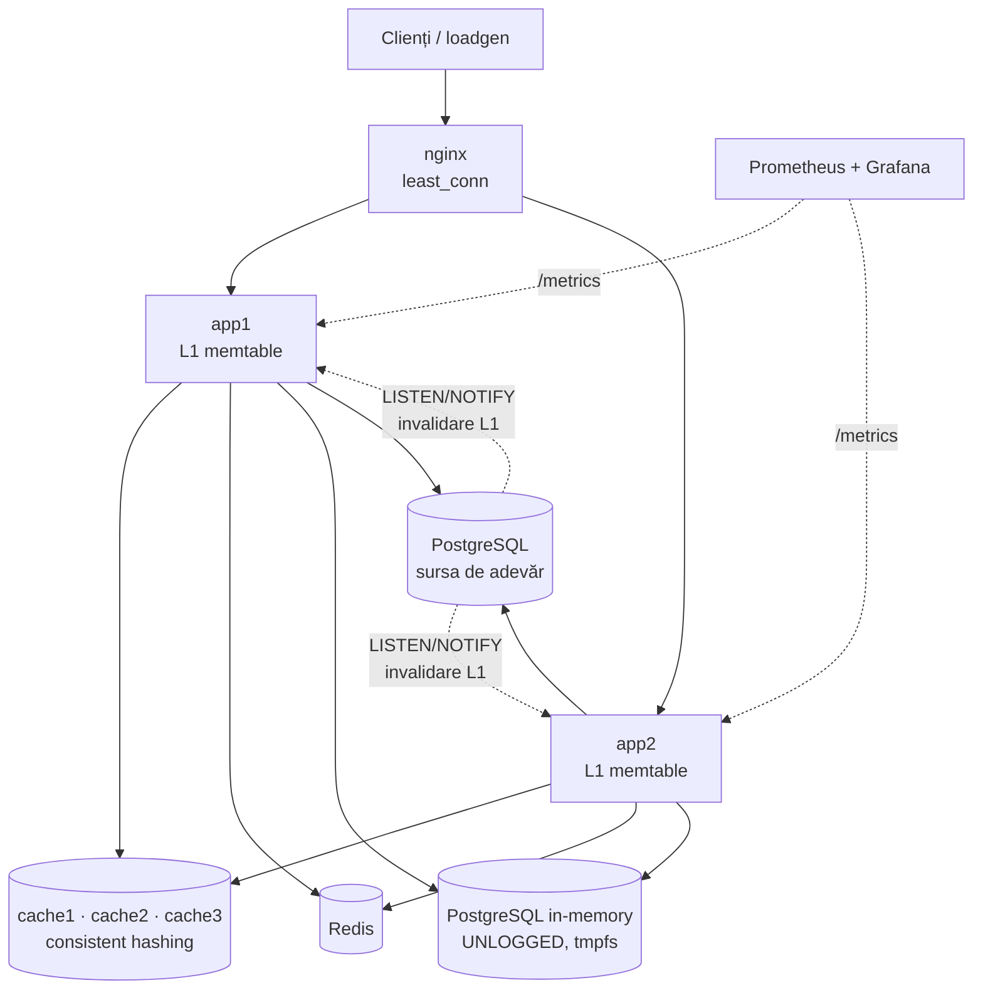

# MemCache Lab: cache in-memory pentru aplicații web

Proiectul implementează un sistem de cache in-memory pentru aplicații web, folosind **tabele in-memory** și o **bază de date relațională** (PostgreSQL), și îi evaluează performanțele. Totul e scris în **Rust** și rulează distribuit cu **Docker Compose**.

- **`memtable`**: motor propriu de tabele in-memory. Are shard-uri cu lock separat, slab cu listă dublu înlănțuită intrusivă (toate operațiile sunt O(1)), politici de evacuare **LRU / FIFO / CLOCK**, **TTL** și **invalidare pe tag-uri**.
- **`cache-node`**: nod de cache distribuit. Folosește un protocol TCP propriu (binary-safe, cu pipelining), iar clientul de cluster distribuie cheile prin **consistent hashing** cu noduri virtuale.
- **`webapp`**: API REST (axum + tokio) peste PostgreSQL, cu **6 backend-uri de cache comutabile la runtime**: `none`, `local`, `cluster`, `tiered` (L1+L2), `redis`, `pgmem` (tabelă `UNLOGGED` pe tmpfs). Suportă **3 strategii de scriere**: invalidate, write-through și write-behind.
- Mecanisme suplimentare:
  - **single-flight** (anti cache-stampede);
  - **invalidare distribuită** prin `LISTEN/NOTIFY`;
  - **write-behind** cu loturi și oprire fără pierderi;
  - **degradare grațioasă** când cache-ul cade.
- Observabilitate și interfață: **Swagger/OpenAPI**, **Prometheus + Grafana** și un **UI** de control cu grafice live și generator de trafic.
- **`loadgen`**: generator de încărcare cu distribuție Zipf și histograme HDR (closed-loop și open-loop), simulator de politici de evacuare și benchmark de scalabilitate.
- Documentația ([`docs/`](docs)) și prezentarea ([`presentation/`](presentation)) sunt scrise în LaTeX. Graficele se generează direct din CSV-urile experimentelor.

## Arhitectură



## Pornire rapidă

Ai nevoie doar de Docker. Rust **nu** trebuie instalat local: `cargo` rulează în container.

```bash
make up            # build + pornește cele 11 servicii
open http://localhost:8080             # UI de control
open http://localhost:8080/swagger-ui/ # documentație API
open http://localhost:3000             # Grafana (dashboard provizionat)
```

| Comandă | Ce face |
|---|---|
| `make check` | `rustfmt --check` + `clippy -D warnings` (pedantic) + teste |
| `make consistency` | test end-to-end de coerență pentru toate cele 18 combinații backend × strategie |
| `make bench` | rulează toate experimentele și scrie `results/*.csv` (~25 min) |
| `make docs` / `make slides` | compilează documentația și prezentarea PDF (LuaLaTeX în Docker) |
| `make down` | oprește stack-ul și șterge volumele |

Poți schimba modul la runtime și din linia de comandă:

```bash
curl -X POST localhost:8080/node/app1/admin/mode -H 'content-type: application/json' \
  -d '{"backend":"tiered","strategy":"write-through","capacity":50000,"policy":"clock"}'
```

## API

| Metodă | Rută | Descriere |
|---|---|---|
| `GET` | `/api/products/{id}` | produs + rating agregat; antetul `X-Cache: HIT/MISS` |
| `GET` | `/api/categories/{id}/top?limit=N` | top produse din categorie |
| `PUT` | `/api/products/{id}` | modifică `price_cents` / `stock` (202 la write-behind) |
| `GET` | `/admin/stats` · `/admin/info` | contoare, mod curent, statistici per nod |
| `POST` | `/admin/mode` · `/admin/reset` | schimbă backend-ul/strategia; resetează contoarele |
| `GET` | `/metrics` · `/health` · `/swagger-ui` | Prometheus, health check, documentație |

## Rezultate

Mediul de test: 5 vCPU (Docker Desktop), toate componentele pe aceeași mașină. Parametri: 64 de clienți, 95% citiri, Zipf s = 0,99, 15 s de măsurare după 5 s de încălzire.

<!-- RESULTS:START -->
**Comparația backend-urilor (E1)**, după optimizări:

| Backend | cereri/s | p50 (ms) | p99 (ms) | hit |
|---|---:|---:|---:|---:|
| `none` (doar PostgreSQL) | 49.410 | 1,08 | 4,9 | — |
| `local` (memtable în proces) | **70.575** | **0,73** | 3,3 | 79,6% |
| `cluster` (3 noduri, consistent hashing) | 62.061 | 0,87 | 3,5 | 87,3% |
| `tiered` (L1 + L2) | 52.502 | 0,94 | 5,2 | 88,6% |
| `redis` | 65.623 | 0,82 | 3,2 | 88,6% |
| `pgmem` (tabelă UNLOGGED în RAM) | 24.279 | 1,83 | 14,4 | 81,9% |

**Optimizări ghidate de profilare** (cache local):

| Pas | cereri/s | p99 (ms) |
|---|---:|---:|
| Inițial (PostgreSQL la 410% CPU) | 12.850 | 62,1 |
| + tuning PostgreSQL, indecși acoperitori | 37.487 | 18,8 |
| + NOTIFY condiționat, calea fierbinte | 37.405 | 15,8 |
| + agregate materializate, `RETURNING` | **67.933** | **3,5** |

Alte rezultate:
- **Strategii de scriere (E3):** la 50% scrieri, write-behind cu 4 benzi partiționate obține 39.652 cereri/s, față de 29.326 cu invalidare, cu de 3,3× mai puține tranzacții.
- **Stampede (E7):** single-flight reduce cu 29% interogările către DB la pornirea la rece.
- **Cost CPU (E8):** cache-ul local reduce CPU-ul per cerere cu 27% (159 → 116 µs).
- **Motorul `memtable`:** 10,4 Mops/s pe un fir; sharding-ul evită colapsul unui mutex unic, iar cheile fierbinți limitează accelerarea la acces Zipf.
<!-- RESULTS:END -->

Analiza completă (8 experimente HTTP, simularea politicilor, scalabilitatea motorului și optimizările ghidate de profilare) e în [`docs/build/main.pdf`](docs).

## Structură

```
crates/
  memtable/     motorul de tabele in-memory (bibliotecă)
  cache-node/   server TCP + client de cluster (consistent hashing)
  webapp/       aplicația web (axum), UI în src/static/index.html
  loadgen/      generator de încărcare + benchmark-uri offline
deploy/         init.sql, nginx, Prometheus, Grafana, Dockerfile-uri auxiliare
scripts/        bench.sh, consistency.sh, profile.sh, plots_data.py, cargo.sh
docs/           documentația LaTeX (capitole, figuri TikZ, date pgfplots)
presentation/   prezentarea Beamer
results/        CSV-urile experimentelor
```

## Calitate

- `clippy` cu `pedantic` la nivel de workspace, rulat cu `-D warnings`; `unsafe_code = "forbid"`.
- `rustfmt`, `.editorconfig` și `cargo-deny` (licențe, vulnerabilități, surse).
- 19 teste unitare și de integrare, plus testul end-to-end de coerență.
- CI în GitHub Actions: formatare, lint, teste, cargo-deny și build Docker.

## Licență

MIT
